# 1. Título del Proyecto

**Little Horizons ERP: Sistema de Gestión Educativa del Colegio Internacional "Little Horizons"**

Aplicación de consola en Java 17 con arquitectura MVC, persistencia en MySQL 8 mediante JDBC y generación de facturas electrónicas en PDF (simulación DIAN).

---

# 2. Descripción

## Propósito

El Colegio Internacional "Little Horizons" atiende a más de 500 estudiantes desde Preescolar hasta grado 11°, con 40 profesores, varias materias y actividades extracurriculares. Este ERP reúne en un solo sistema los procesos **académicos, administrativos y financieros** que antes se manejaban en papel y hojas de cálculo sueltas.

## Problemas que resuelve

| Problema del colegio | Cómo lo resuelve el ERP |
|---|---|
| Notas en cuadernos que se pierden | Registro de notas en MySQL, historial completo por estudiante y promedios calculados automáticamente |
| No se sabe quién está en cada club o evento | Catálogo de clubes con cupo, membresías con fecha de ingreso y retiro, eventos con participantes y posiciones |
| Facturación manual lenta y con errores | Cada pago genera una factura electrónica PDF con CUFE, código QR y resolución (simulados) |
| Libros y equipos que "se pierden" | Inventario de recursos y préstamos a estudiantes o profesores, con control de devoluciones y vencimientos |
| Profesores sin visibilidad del rendimiento | Reportes de estudiantes con promedio menor a 3.0, mejores promedios e inasistencias preocupantes |

## Funcionalidades principales

- CRUD de estudiantes (creados con *Builder*), acudientes y profesores.
- Matrícula por grado y año, e inscripción en materias por período.
- Registro de notas (0.0 a 5.0) con validación de inscripción y de asignación del profesor; promedios con Stream API.
- Asistencia diaria por materia y reporte de más de 3 ausencias en una semana.
- Asignación de materias a profesores y horarios de clase con detección de choques.
- Clubes con cupo máximo, membresías activas o retiradas, eventos con competencia y posiciones.
- Conceptos de pago, valores personalizados (descuento por hermanos, becas), pagos con recibo consecutivo e historial por estudiante o por acudiente.
- Factura electrónica PDF automática (OpenPDF + ZXing) con IVA calculado mediante el patrón *Strategy*.
- Recursos, préstamos y devoluciones con transacciones, y préstamos vencidos.
- 9 reportes con lambdas y Streams, y visor de las últimas 20 líneas de `error_log.txt`.

---

# 3. Autores

| Nombre completo | Correo electrónico | Contacto |
|---|---|---|
| Leonel Escalona | ledre1018@gmail.com | Por correo electrónico |

---

# 4. Tecnologías Utilizadas

| Tipo | Tecnología | Versión |
|---|---|---|
| Lenguaje | Java (JDK) | 17 |
| IDE | IntelliJ IDEA Community Edition | 2023.3 o superior |
| Construcción y dependencias | Apache Maven | 3.6.3 o superior |
| Base de datos | MySQL Community Server | 8.0 o superior |
| Driver JDBC | `com.mysql:mysql-connector-j` | 26.10.0 |
| Generación de PDF | `com.github.librepdf:openpdf` | 2.0.5 |
| Código QR | `com.google.zxing:core` y `com.google.zxing:javase` | 3.5.4 |
| Ejecución desde Maven | `org.codehaus.mojo:exec-maven-plugin` | 3.5.0 |
| Control de versiones | Git | 2.x |

> OpenPDF 2.0.5 es la última versión compatible con Java 17. Las versiones 2.2.x, 2.4.x y 3.x están compiladas para Java 21.

---

# 5. Requerimientos Previos

| Software | Versión mínima | Para qué se usa |
|---|---|---|
| JDK | **17** | Compilar y ejecutar la aplicación |
| **MySQL Server** | **8.0 o superior (obligatorio)** | Base de datos. Las restricciones `CHECK` del script solo se aplican desde MySQL 8.0.16 |
| Maven | 3.6.3 | Descargar dependencias, compilar y ejecutar |
| Git | 2.x | Clonar el repositorio |
| IntelliJ IDEA | 2023.3 (opcional) | Abrir, compilar y ejecutar desde el IDE |
| Consola con UTF-8 | — | Para ver bien tildes y bordes del menú (la aplicación fuerza UTF-8 en su salida) |

Comprobar versiones:

```bash
java -version      # 17.x
mvn -v             # 3.6.3 o superior
mysql --version    # 8.0.x o superior
```

---

# 6. Configuración de la Base de Datos

## 6.1. Creación de la base de datos

El script completo está en **`docs/database.sql`** y tiene dos secciones separadas por encabezados:

- **SECCIÓN 1 - DDL:** borra y vuelve a crear la base `erp_little_horizons` con todas sus tablas, llaves primarias y foráneas, índices, `UNIQUE` y `CHECK`.
- **SECCIÓN 2 - DML:** datos iniciales del anexo (grados, categorías de recurso, conceptos de pago) y datos de prueba coherentes.

### Crear un usuario MySQL dedicado (recomendado)

En Ubuntu el usuario `root` de MySQL suele autenticarse con `auth_socket` (solo entra con `sudo mysql`), por lo que Java no puede usarlo. Cree un usuario propio para la aplicación:

```bash
sudo mysql
```

```sql
CREATE USER 'erp_user'@'localhost' IDENTIFIED BY 'TuContraseñaSegura';
GRANT ALL PRIVILEGES ON erp_little_horizons.* TO 'erp_user'@'localhost';
FLUSH PRIVILEGES;
```

> El privilegio sobre `erp_little_horizons.*` permite al usuario ejecutar el `DROP DATABASE`/`CREATE DATABASE` del script aunque la base todavía no exista.

### Ejecutar el script

```bash
mysql -u erp_user -p < docs/database.sql
```

Al final, el script muestra la lista de tablas creadas. Cantidad de datos de prueba por tabla principal:

| Tabla | Registros | Tabla | Registros |
|---|---|---|---|
| estudiantes | 36 | pagos | 549 |
| acudientes | 33 | clubes | 30 |
| profesores | 30 | recursos | 36 |
| materias | 36 | asistencias | 972 |
| registros_academicos | 393 | inscripciones_materia | 708 |
| membresias_club | 52 | participantes_evento | 69 |
| asignaciones_profesor | 77 | horarios_clase | 82 |
| prestamos_estudiante | 16 | prestamos_profesor | 8 |
| valores_concepto_estudiante | 13 | matriculas | 59 |

Los datos son coherentes entre sí:
- Todo estudiante tiene al menos un acudiente y una matrícula activa en 2026, y 11 acudientes tienen varios hijos.
- Las notas son de materias del grado del estudiante, puestas por el profesor que tiene la materia asignada.
- Los pagos los hace un acudiente vinculado al estudiante, con recibos `RC-000001` en adelante.
- Hay estudiantes con promedio menor a 3.0, cuatro estudiantes morosos, tres con más de 3 ausencias en una semana, y préstamos devueltos, activos y vencidos.

### Cambios realizados al script del anexo (con justificación)

El DDL del anexo (versión 2.0) se conserva **completo y sin modificar**. Solo se agregaron dos tablas, marcadas en el script como `[CAMBIO 1]` y `[CAMBIO 2]`:

| Cambio | Tabla nueva | Justificación |
|---|---|---|
| 1 | `horarios_clase` (`id_asignacion`, `dia_semana`, `hora_inicio`, `hora_fin`, `CHECK hora_fin > hora_inicio`) | El enunciado (1.2) exige registrar **en qué días y horas** cada profesor dicta cada materia para evitar conflictos. El anexo solo tiene `asignaciones_profesor` (profesor, materia, año, sección) y no tiene dónde guardar días ni horas. La tabla depende de la asignación (`ON DELETE CASCADE`). |
| 2 | `valores_concepto_estudiante` (`id_estudiante`, `id_concepto`, `año_academico`, `monto_personalizado`, `motivo`, `UNIQUE` por estudiante + concepto + año) | El enunciado (3.1) exige **ajustar el valor de un concepto para estudiantes específicos** (descuento por hermanos, becas parciales). El anexo solo tiene `conceptos_pago.monto_base`, que es igual para todos. |

Nota sobre el nombre: el comentario inicial del anexo menciona `little_horizons_erp`, pero el propio script (`CREATE DATABASE erp_little_horizons`) y el enunciado usan **`erp_little_horizons`**, que es el nombre usado.

## 6.2. Configuración de credenciales

Las credenciales **no están en el código ni en el repositorio**. Se leen del archivo `src/main/resources/config.properties`, que está en `.gitignore`.

1. Copie el archivo de ejemplo:
   ```bash
   cp src/main/resources/config.example.properties src/main/resources/config.properties
   ```
2. Edite sus valores:
   ```properties
   db.url=jdbc:mysql://localhost:3306/erp_little_horizons
   db.user=erp_user
   db.password=TuContraseñaSegura
   ```

La clase `util.DatabaseConnection` (*Singleton*) lee este archivo una sola vez con `try-with-resources` y entrega una conexión nueva en cada `getConnection()`. Si el archivo falta o las credenciales son incorrectas, la aplicación muestra un mensaje claro y registra el detalle en `error_log.txt`.

## 6.3. Instalación del driver JDBC

**Opción A: con Maven (recomendada).** El driver ya está declarado en `pom.xml` y Maven lo descarga solo:

```xml
<dependency>
    <groupId>com.mysql</groupId>
    <artifactId>mysql-connector-j</artifactId>
    <version>26.10.0</version>
</dependency>
```

```bash
mvn dependency:resolve
```

**Opción B: manual en IntelliJ IDEA (sin Maven).**
1. Descargue `mysql-connector-j-26.10.0.jar` desde <https://dev.mysql.com/downloads/connector/j/> (opción *Platform Independent*).
2. En IntelliJ: `File > Project Structure > Modules > Dependencies > + > JARs or Directories...` y seleccione el `.jar`.
3. Haga lo mismo con los `.jar` de OpenPDF 2.0.5 y ZXing 3.5.4 (`core` y `javase`).
4. Marque el *scope* `Compile` y presione `Apply`.

---

# 7. Instalación y Ejecución

## 7.1. Clonar el repositorio

```bash
git clone https://github.com/<usuario>/little-horizons-erp.git
cd little-horizons-erp
```

## 7.2. Abrir el proyecto en el IDE

1. IntelliJ IDEA: `File > Open...` y seleccione el archivo `pom.xml` (abrir *como proyecto*).
2. Espere a que Maven descargue las dependencias (ventana *Maven*, botón *Reload*).
3. Verifique `File > Project Structure > Project SDK = 17`.
4. Cree `src/main/resources/config.properties` (sección 6.2) y ejecute `docs/database.sql` (sección 6.1).

## 7.3. Compilar

```bash
mvn clean compile
```

## 7.4. Ejecutar

Desde la terminal, en la raíz del proyecto:

```bash
mvn compile exec:java
```

Desde IntelliJ: abra `src/main/java/com/littlehorizons/erp/Main.java` y presione *Run 'Main.main()'*.

> Ejecute siempre desde la raíz del proyecto: ahí se crean `error_log.txt` y la carpeta `invoices/` con las facturas PDF.

---

# 8. Estructura del Proyecto

## Arquitectura MVC

```
Usuario ─▶ View (consola) ─▶ Controller (reglas de negocio) ─▶ DAO (interfaces) ─▶ JDBC ─▶ MySQL
                ▲                     │
                └──── objetos Model ◀─┘
```

| Capa | Responsabilidad | Reglas que se cumplen |
|---|---|---|
| **View** (`view`) | Mostrar menús y tablas, leer datos con validación | Solo llama a Controllers. No importa nada de `dao` ni escribe SQL |
| **Controller** (`controller`) | Validar reglas de negocio, coordinar DAOs, calcular con Streams | No imprime nada (cero `System.out`). Recibe los DAO como interfaces por constructor |
| **Model** (`model` + `dao`) | Entidades del dominio, enums y acceso a datos | Todo el SQL vive en `dao.jdbc`, siempre con `PreparedStatement` |
| **Main** | Solo arranca la aplicación | Configura UTF-8, crea las fábricas y abre el menú; tiene el `catch` global |

## Paquetes

```
src/main/java/com/littlehorizons/erp/
├── Main.java                     Punto de entrada (solo arranca)
├── model/                        Entidades, enums y resultados de cálculos (47 clases)
├── dao/                          Interfaces DAO (una por agregado) y DaoFactory
│   └── jdbc/                     Implementaciones JDBC, BaseJdbcDao, RowMapper, SqlErrorTranslator
├── controller/                   Reglas de negocio por módulo y ControllerFactory
│   ├── tax/                      Estrategias de impuesto (Strategy) y su fábrica
│   └── report/                   Reportes del módulo 7 (interfaz Report y 9 implementaciones)
├── view/                         Menús de consola: una View por módulo + MainMenuView
└── util/                         Conexión, logger, lectura de consola, impresión de tablas, PDF, CUFE, QR
docs/database.sql                 Script DDL + DML
invoices/                         Facturas PDF generadas (se crea sola; los PDF no se versionan)
error_log.txt                     Log de la aplicación (se crea solo; no se versiona)
```

| Paquete | Clases principales |
|---|---|
| `model` | `Person` (abstracta) → `Student`, `Guardian`, `Teacher`; `Loan` (abstracta) → `StudentLoan`, `TeacherLoan`; `Grade`, `Enrollment`, `Subject`, `SubjectRegistration`, `AcademicRecord`, `Attendance`, `TeacherAssignment`, `ClassSchedule`, `Club`, `ClubMembership`, `SchoolEvent`, `EventParticipant`, `PaymentConcept`, `StudentConceptPrice`, `Payment`, `Invoice`, `InvoiceLine`, `Resource`, `ResourceCategory`; 16 enums (`PaymentMethod`, `AttendanceStatus`...); resultados (`StudentSubjectAverage`, `AbsenceAlert`, `DelinquentRecord`, `PaymentResult`) |
| `dao` | `StudentDao`, `GuardianDao`, `PaymentDao`, `LoanDao<T extends Loan>` y 18 más; `DaoFactory` |
| `dao.jdbc` | `BaseJdbcDao` (pasos comunes de JDBC), `JdbcLoanDao<T>` (transacciones de préstamos), `JdbcStudentDao`, `JdbcPaymentDao`...; `RowMapper` (interfaz funcional propia); `SqlErrorTranslator` |
| `controller` | `StudentController`, `GuardianController`, `EnrollmentController`, `AcademicController`, `AttendanceController`, `TeacherController`, `AssignmentController`, `ClubController`, `EventController`, `PaymentConceptController`, `PaymentController`, `ResourceController`, `LoanController`, `ReportController`, `ControllerFactory` |
| `controller.tax` | `TaxStrategy`, `VatExemptTaxStrategy`, `IncludedVatTaxStrategy`, `TaxStrategyFactory` |
| `controller.report` | `Report`, `ReportTable` y los 9 reportes |
| `view` | `BaseView` (abstracta), `MainMenuView`, `StudentView`, `AcademicView`, `TeacherView`, `ExtracurricularView`, `FinanceView`, `ResourceView`, `ReportView`, `OperationCancelledException` |
| `util` | `DatabaseConnection`, `AppLogger`, `LogLevel`, `LogFileReader`, `ConsoleInput`, `ConsolePrinter`, `TableRowFormatter`, `ConsoleEncoding`, `TextFormat`, `DataAccessException`, `BusinessRuleException`, `InvoiceDocumentGenerator`, `PdfInvoiceGenerator`, `InvoiceGenerationException`, `CufeGenerator`, `QrCodeGenerator`, `SchoolInfo` |

## Relaciones entre clases

| Relación | Ejemplo real en el código | Por qué |
|---|---|---|
| **Herencia** | `Student`, `Guardian` y `Teacher` extienden `Person`; `StudentLoan` y `TeacherLoan` extienden `Loan` | Comparten atributos (documento, nombres, contacto / fechas y estado del préstamo) y sobrescriben (`@Override`) `getRoleName()`, `getBorrowerId()` y `getBorrowerType()` |
| **Asociación** | `StudentGuardian` une un estudiante con un `Guardian` (con los indicadores principal y emergencia). `Payment` referencia al estudiante, al acudiente y al concepto por id | Estudiante y acudiente existen por separado; un acudiente puede tener varios hijos y un estudiante varios acudientes |
| **Agregación** | `ReportController` recibe una `List<Report>`; `ControllerFactory` agrupa los controladores; `Invoice` tiene un `Guardian customer` | Los reportes, controladores y el acudiente existen aunque el contenedor desaparezca |
| **Composición** | `Invoice` con sus `InvoiceLine`: las líneas solo se crean con `Invoice.addLine(...)` (el constructor de `InvoiceLine` no es público) y `getLines()` devuelve una copia | Una línea de factura no tiene sentido fuera de su factura: nace y muere con ella |
| **Dependencia por interfaz** | `PaymentController` depende de `PaymentDao`, `InvoiceDocumentGenerator` y `TaxStrategyFactory`, inyectados por constructor | Bajo acoplamiento: se puede cambiar la implementación sin tocar el controlador |

---

# 9. Principios y Patrones de Diseño Aplicados

## 9.1. Principios SOLID

| Principio | Ejemplo real en el código |
|---|---|
| **S: Single Responsibility** (una clase, una razón para cambiar) | `AppLogger` solo escribe el log, `LogFileReader` solo lo lee, `ConsoleInput` solo lee y valida entradas, `ConsolePrinter` solo imprime. En facturación, `PaymentController.registerPayment()` aplica las reglas, `JdbcPaymentDao.insertWithInvoice()` guarda, `CufeGenerator.generate()` calcula el hash y `PdfInvoiceGenerator.generate()` dibuja el PDF. |
| **O: Open/Closed** (abierto a extensión, cerrado a modificación) | **Nuevo impuesto:** se crea otra clase que implemente `TaxStrategy` y se registra en el constructor de `TaxStrategyFactory`; `PaymentController.buildInvoice()` no cambia. **Nuevo reporte:** se crea una clase que implemente `Report` y se agrega en `ControllerFactory.buildReports()`; `ReportController` y `ReportView` muestran cualquier reporte sin modificarse. |
| **L: Liskov Substitution** (las subclases sustituyen a la base) | `LoanController.registerLoan(LoanDao<T> loanDao, T loan)` funciona igual con `JdbcStudentLoanDao` o `JdbcTeacherLoanDao` y con cualquier `Loan`. `ResourceView.printLoans(List<Loan>)` imprime préstamos de estudiantes y profesores usando solo métodos de `Loan`. `BaseView.updatePersonData(Person)` sirve para `Student`, `Guardian` y `Teacher`. |
| **I: Interface Segregation** (interfaces pequeñas) | Cada agregado tiene su propia interfaz DAO con solo lo que necesita: `GradeDao`, `SubjectDao` y `ResourceCategoryDao` solo leen (son catálogos fijos), `InvoiceDao` solo tiene `findAll()` y `ClassScheduleDao` dos métodos. Ningún controlador depende de métodos que no usa. |
| **D: Dependency Inversion** (depender de abstracciones) | Los controladores reciben interfaces por constructor: `StudentController(StudentDao, GuardianDao, PaymentDao)`, `PaymentController(..., InvoiceDocumentGenerator)`. Solo `DaoFactory` conoce las clases `Jdbc...`, y solo `ControllerFactory` hace `new` de `PdfInvoiceGenerator`. |

## 9.2. Patrones de Diseño

| Patrón | Dónde se aplica | Justificación |
|---|---|---|
| **Singleton** | `util.DatabaseConnection.getInstance()` y `util.AppLogger.getInstance()` (constructores privados y `getInstance()` `synchronized`) | La configuración se lee una sola vez y todo el programa comparte la misma instancia. El método de escritura del log también es `synchronized`, para que dos escrituras no se mezclen en el archivo. `getConnection()` entrega una conexión **nueva** cada vez para que el DAO la cierre con `try-with-resources`. |
| **DAO** | Interfaces en `dao` (`StudentDao`, `PaymentDao`, `LoanDao<T>`...) e implementaciones en `dao.jdbc` | Separa el acceso a datos de las reglas de negocio. Todo el SQL, `Connection`, `PreparedStatement` y `ResultSet` viven solo aquí. |
| **Factory** | `dao.DaoFactory` (crea los DAO), `controller.ControllerFactory` (crea e inyecta los controladores), `controller.tax.TaxStrategyFactory.forConcept(code)` (elige la estrategia de impuesto) | Centraliza la creación de objetos: si mañana se cambia JDBC por otra tecnología, solo cambia `DaoFactory`. |
| **Strategy** | `controller.tax.TaxStrategy` con `VatExemptTaxStrategy` (0 %) e `IncludedVatTaxStrategy` (19 % incluido) | El cálculo del IVA cambia según el concepto pagado. Regla simulada: el concepto `UNIFORME` (un bien) lleva IVA del 19 % **incluido** en el monto pagado (`IVA = total − total / 1.19`); los demás conceptos son servicios educativos **exentos**. |
| **Builder** | `model.Student.Builder`, usado en `StudentView.registerStudent()` y en `JdbcStudentDao.mapStudent()` | `Student` tiene 4 datos obligatorios y más de 10 opcionales. El *Builder* evita un constructor gigante y deja claro qué dato es cada uno. |

Además se usa **Template Method** en `BaseJdbcDao` (abrir conexión, poner parámetros, ejecutar y cerrar) y en `JdbcLoanDao<T>` (las transacciones de préstamo son iguales; cada subclase solo da su SQL y su `mapLoan`).

## 9.3. Lambdas y Stream API

| Elemento | Dónde |
|---|---|
| `Predicate`, `Function`, `Supplier` | `ConsoleInput.readValidated(prompt, Function converter, Predicate validator, error)` es el método genérico de lectura con reintento; `readDateOrDefault(prompt, Supplier<LocalDate>)` |
| `Consumer` | `PaymentDao.insertWithInvoice(payment, invoice, Consumer<Invoice> invoiceCompleter)`: el controlador pasa la lambda que calcula CUFE y nombre del PDF dentro de la transacción |
| Interfaces funcionales propias (`@FunctionalInterface`) | `dao.jdbc.RowMapper<T>` (puede lanzar `SQLException`, que `Function` no permite) y `util.TableRowFormatter<T>` (convierte un objeto en una fila de tabla) |
| `Runnable` | `BaseView.runAction(Runnable action)` ejecuta cada opción del menú con manejo de errores |
| `filter`, `map`, `toList` | Todos los controladores (búsquedas, materias del grado, conceptos activos...) |
| `anyMatch` | Validaciones de duplicados: matrícula por año, inscripción, nota, membresía activa, posición de podio, acudiente vinculado |
| `flatMap` | `PaymentController.getPaymentsByGuardian()` (pagos de todos los hijos) y `AttendanceController.findConcerningAbsences()` |
| `groupingBy` + `counting` | Ausencias por estudiante y semana, participantes por evento, miembros activos por club |
| `groupingBy` + `averagingDouble` | `AcademicController.getSubjectAverages()`, `getCourseAverages()` y `getPeriodAverage()` |
| `sorted` y `collect` | Mejores promedios, morosos por días de atraso, préstamos por fecha, pagos por método y por concepto |

---

# 10. Funcionalidades Principales

### Menú principal

```
╔══════════════════════════════════════════════╗
║   ERP Colegio Little Horizons                ║
║   Sistema de Gestión Educativa               ║
╚══════════════════════════════════════════════╝

1. Gestión de Estudiantes
2. Gestión Académica
3. Gestión de Profesores
4. Actividades Extracurriculares
5. Gestión Financiera
6. Gestión de Recursos
7. Reportes y Estadísticas
8. Salir

Seleccione una opción:
```

En cada submenú, la opción **0** vuelve al menú principal. Dentro de una operación, escribir **0** al pedir un ID la cancela y regresa al menú. Toda entrada inválida muestra un mensaje y se vuelve a pedir, y antes de eliminar se pide confirmación (S/N).

### Módulo 1: Gestión de Estudiantes
- Listar, buscar por nombre, ver ficha completa (datos personales, médicos, acudientes con indicador de **contacto de emergencia**, matrículas).
- Registrar estudiante: **exige un acudiente existente**; el estudiante y el vínculo se guardan en una sola transacción (`JdbcStudentDao.insertWithGuardian`).
- Actualizar y eliminar (con confirmación). No se elimina un estudiante con pagos: se cambia su estado a *Retirado*.
- CRUD de acudientes; vincular acudientes adicionales; ver los estudiantes (hermanos) de un acudiente. No se elimina el único acudiente de un estudiante.
- Matrícula por grado (Preescolar a Once) y año, **una por año**; cambio de estado (*Activa, Completada, Retirada*).
- Inscripción en materias por período (I a IV), **solo materias del grado actual**.

### Módulo 2: Gestión Académica
- Registrar nota (0.0 a 5.0, un decimal) por materia y período (I, II, III, IV, Final). Valida que el estudiante esté inscrito y que el profesor tenga la materia asignada.
- Historial completo de notas desde el ingreso.
- Promedios automáticos con Streams: por materia de cada estudiante, general del estudiante en un período y general del curso en cada materia.
- Asistencia diaria (*Presente, Ausente, Tardanza, Excusa Médica*), una por estudiante, materia y fecha.
- Reporte de estudiantes con **más de 3 ausencias en una misma semana** (lunes a domingo).

### Módulo 3: Gestión de Profesores
- CRUD de profesores y búsqueda por especialización.
- Asignación de materias por año y sección (un profesor varias materias, una materia varios profesores).
- Horarios de clase con **validación de choques**: `ClassSchedule.overlapsWith()` compara día y rango de horas con las demás clases del mismo profesor.

### Módulo 4: Actividades Extracurriculares
- CRUD de clubes (descripción, cupo máximo, profesor encargado, horario).
- Inscripción validando **cupo máximo** y que no exista una **membresía activa duplicada**; retiro con fecha y motivo.
- CRUD de eventos (*Académico, Cultural, Deportivo, Social, Científico*); registro de participantes con rol. Si el evento tiene competencia, se exige la posición (*1er Lugar, 2do Lugar, 3er Lugar, Participante*) y cada puesto del podio solo se asigna una vez.

### Módulo 5: Gestión Financiera
- CRUD de conceptos de pago y valores personalizados por estudiante (descuento por hermanos, becas).
- Registrar pago: estudiante, acudiente vinculado que paga, concepto, monto (sugiere el valor personalizado o, si no existe, el base), fecha, método, período y **recibo consecutivo único** `RC-000001` generado por el sistema.
- **Factura electrónica automática** al confirmar el pago (ver abajo) y consulta de las facturas generadas con su ruta.
- Historial de pagos por estudiante y por acudiente (todos sus hijos).
- **Regla de morosos:** un estudiante *activo* es moroso en un concepto **recurrente** (`es_recurrente = TRUE`) cuando su último pago de ese concepto tiene **más de un mes** (fecha anterior a hoy menos un mes) o nunca lo ha pagado. La pensión (`PENSION`) aplica a todos los estudiantes; transporte y alimentación solo aplican a quienes los han pagado alguna vez.

**Factura electrónica (simulación DIAN).** Se crea en `invoices/factura_000123.pdf`.

| Parte | Contenido |
|---|---|
| Colegio | Colegio Internacional Little Horizons S.A.S., NIT, dirección, teléfono y correo (constantes de `SchoolInfo`) |
| Cliente | Acudiente que paga: nombre, documento y dirección |
| Detalle | Número consecutivo `FE-000123`, fecha de emisión, tabla de líneas (descripción, cantidad, valor unitario, subtotal), subtotal, IVA y total |
| DIAN simulada | **CUFE** (SHA-384 en hexadecimal de número + NIT + fecha + total), **código QR** (ZXing) con los datos y el CUFE, y resolución de habilitación simulada (número, fecha y rango) |

- El número de recibo y el de factura se calculan **dentro de la transacción** (`SELECT ... FOR UPDATE`), así que no se repiten aunque se registren varios pagos seguidos.
- Si el PDF falla, el pago no se pierde: queda registrado, el error va al log y se avisa al usuario.

### Módulo 6: Gestión de Recursos
- CRUD de recursos (código único, nombre, categoría, estado, ubicación).
- Préstamo a estudiante o profesor (tablas separadas). El recurso debe estar *Disponible* y la devolución programada debe ser posterior al préstamo. Préstamo y cambio a *Prestado* van en una transacción.
- Devolución: registra la fecha real; el préstamo queda *Devuelto* y el recurso vuelve a *Disponible* (transacción).
- Los préstamos *Activos* con fecha vencida pasan a *Vencido* (`markOverdue`) y se reportan.

### Módulo 7: Reportes y Estadísticas
1. Inasistencias preocupantes.
2. Estudiantes morosos.
3. Préstamos vencidos.
4. Estudiantes que necesitan apoyo (promedio < 3.0) por curso y materia.
5. Mejores promedios por curso y materia.
6. Participación por evento.
7. Participación por club (activos, cupo y % de ocupación).
8. Resumen de pagos por método de pago.
9. Resumen de pagos por concepto.
10. **Ver últimas 20 líneas del log de errores** (lectura de `error_log.txt` con `BufferedReader`).

---

# 11. Manejo de Errores y Logs

## Sistema de logging

- Clase `util.AppLogger` (*Singleton*), con escritura `synchronized` mediante `BufferedWriter`/`FileWriter` en **modo append** dentro de `try-with-resources`.
- Archivo: **`error_log.txt` en la raíz del proyecto** (directorio desde donde se ejecuta). Se crea solo y no se versiona.
- Niveles (`util.LogLevel`): `INFO` (inicio y cierre, pagos registrados, reportes, entradas inválidas), `WARNING` (reglas de negocio incumplidas, datos inválidos, rollbacks) y `ERROR` (errores SQL, de PDF o inesperados, **con stack trace**).
- Formato de cada línea:
  ```
  [2026-11-10 20:13:53] [INFO] [PaymentController.registerPayment] Payment RC-000551 saved with invoice FE-000002
  [2026-11-10 20:15:02] [ERROR] [JdbcTeacherDao.executeUpdate] SQL error 1451: Cannot delete or update a parent row...
  java.sql.SQLIntegrityConstraintViolationException: ...
  ```
- Si el archivo no se puede escribir, el programa sigue funcionando y avisa una sola línea por `System.err`.
- El log se puede consultar desde el menú *7. Reportes > Ver últimas 20 líneas del log de errores* (`util.LogFileReader`).

## Estrategia de excepciones

| Excepción | Quién la lanza | Cómo se maneja |
|---|---|---|
| `SQLException` | JDBC | Se captura **solo en los DAO**, se registra con `ERROR` y se relanza como `DataAccessException` con un mensaje en español (`SqlErrorTranslator`: 1062 duplicado, 1451 registro en uso, 1452 relación inexistente, 3819 `CHECK`, 1045 credenciales, conexión caída...) |
| `DataAccessException` (propia) | DAO, `DatabaseConnection` | La View muestra el mensaje amigable |
| `BusinessRuleException` (propia) | Controllers | La View muestra el mensaje y se registra como `WARNING` |
| `IllegalArgumentException` | Setters de las entidades (validación) | Igual que la anterior |
| `InvoiceGenerationException` (propia) | `PdfInvoiceGenerator` | `PaymentController` la registra; el pago se conserva y se avisa al usuario |
| `OperationCancelledException` (propia) | `BaseView.readId()` cuando el usuario escribe 0 | Vuelve al menú (registro `INFO`) |
| `NumberFormatException`, `DateTimeParseException` | Lectura de consola | `ConsoleInput.readValidated()` muestra el error y vuelve a pedir el dato |
| Cualquier otra (`Exception`) | Inesperada | **`catch` global en `Main`**: se registra con stack trace y se muestra un mensaje amigable |

- Todas las operaciones de varios pasos usan `setAutoCommit(false)`, `commit()` y `rollback()`: estudiante + vínculo con acudiente, pago + factura, préstamo + estado del recurso, y devolución + estado del recurso.
- La consola **nunca** muestra stack traces; solo mensajes claros.

---

# 12. Capturas de Pantalla

Evidencia del funcionamiento de la aplicación. Las imágenes están en `docs/screenshots/`.

### 1. Menú principal con el recuadro
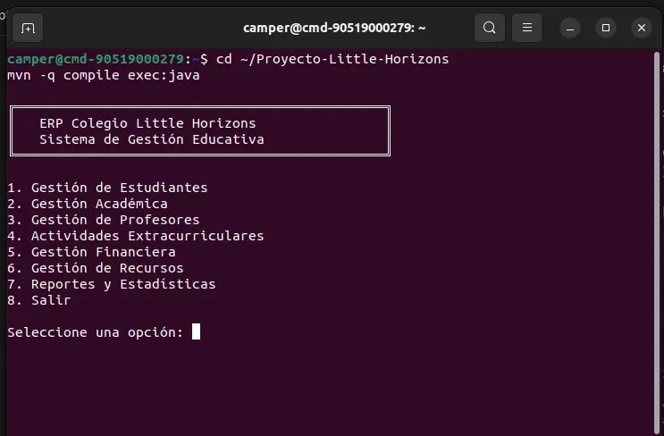

### 2. Listado de estudiantes en tabla alineada
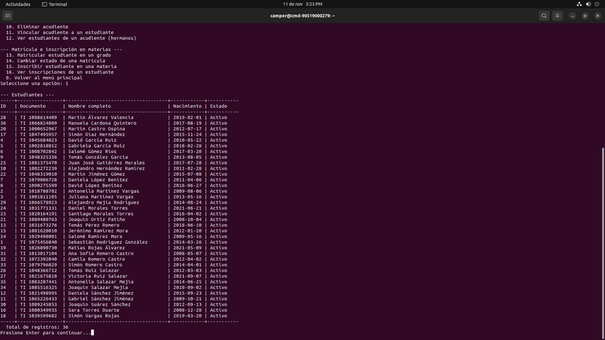

### 3. Registro de un estudiante con su acudiente
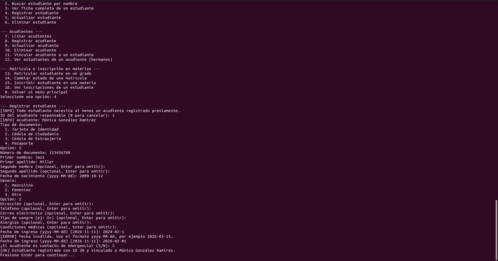

### 4. Entrada inválida con mensaje de error y reintento
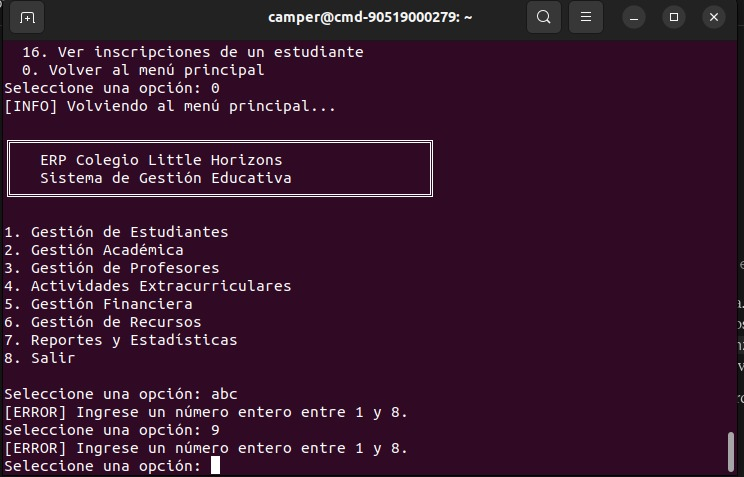

### 5. Registro de nota y promedios por materia
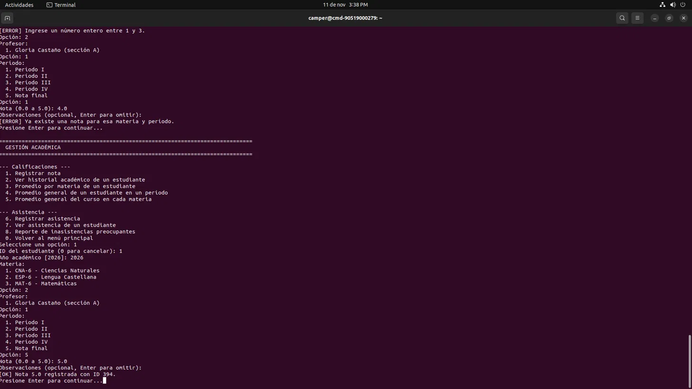

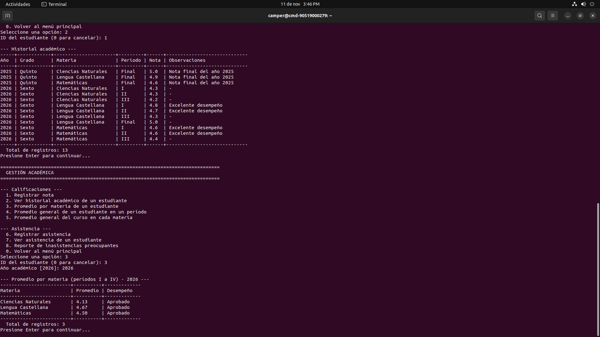

### 6. Registro de un pago con la ruta de la factura generada
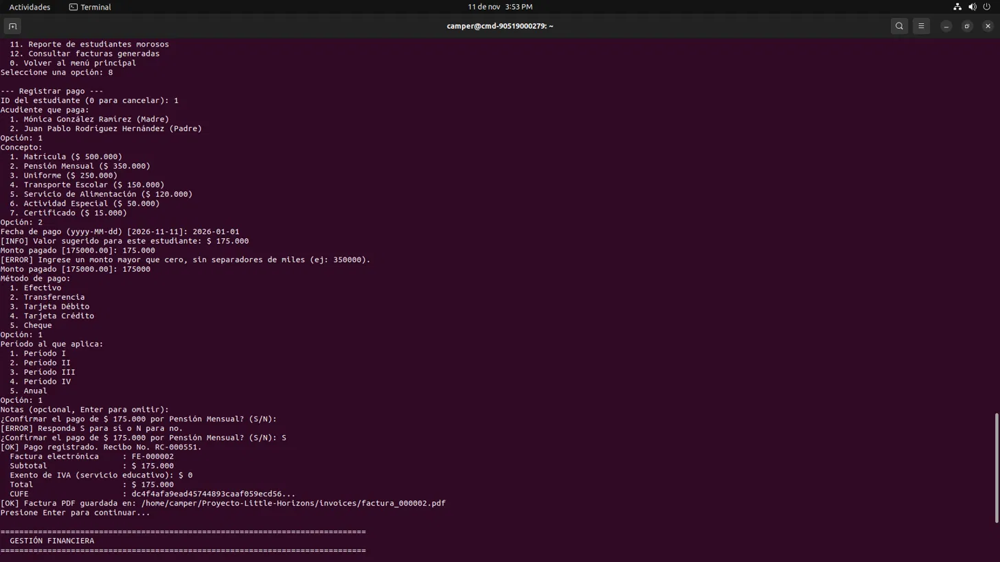

### 7. Factura electrónica PDF con CUFE, código QR y totales
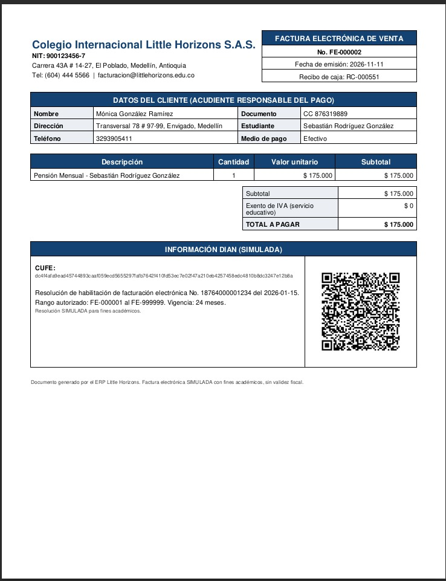

### 8. Préstamo y devolución de un recurso
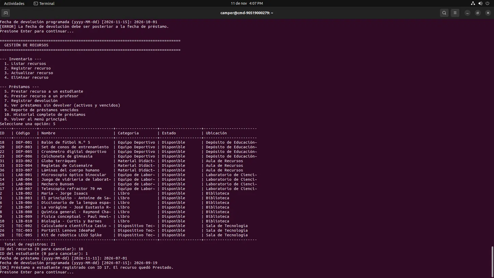

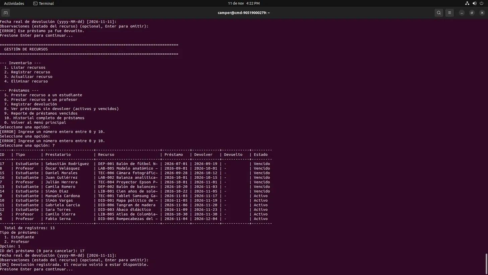

### 9. Reporte de estudiantes morosos
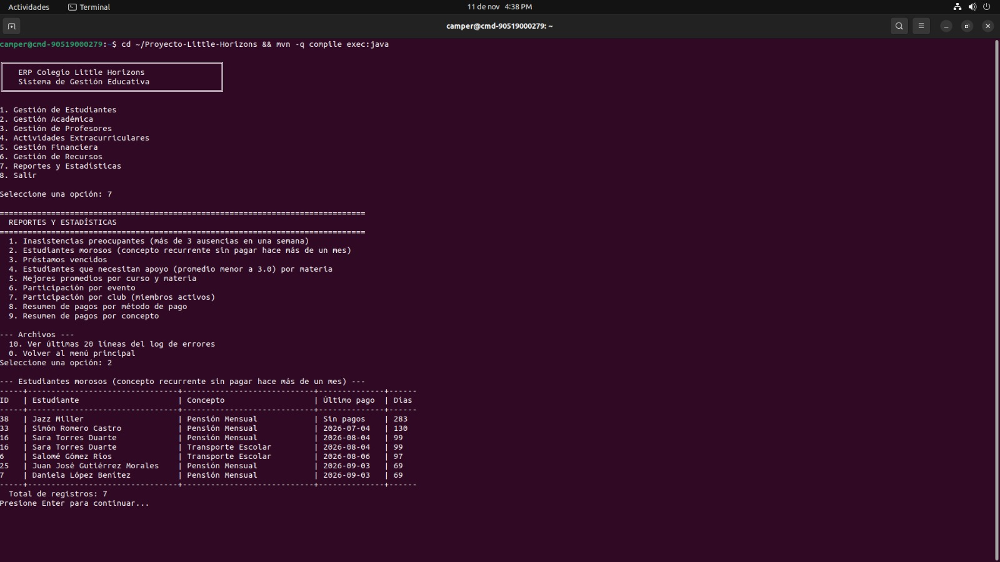

### 10. Últimas 20 líneas de error_log.txt desde el menú
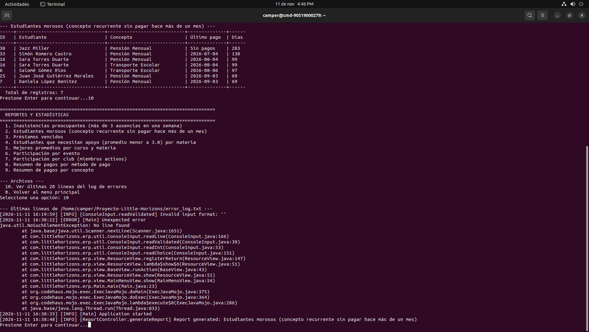

---

# 13. Problemas Conocidos y Limitaciones

### Decisiones tomadas ante ambigüedades

1. **Valores de los ENUM:** se respetan exactamente los del DDL del anexo aunque el enunciado nombre otros:
   - membresías *Activa/Retirada*;
   - métodos de pago *Efectivo, Transferencia, Tarjeta Débito, Tarjeta Crédito, Cheque*;
   - estado del estudiante también *Suspendido*;
   - tipo de evento también *Científico*.
2. **Posición en eventos:** la columna es `VARCHAR`; en Java es el enum `CompetitionPosition`. Solo se guarda si el evento tiene competencia, y cada puesto del podio (1°, 2° y 3°) se asigna una sola vez por evento.
3. **Contactos de emergencia:** son los acudientes vinculados con `es_contacto_emergencia = TRUE` (el anexo no tiene otra tabla para ellos).
4. **Promedios por materia:** usan los períodos I a IV. La nota *Final* se muestra en el historial pero no entra al promedio, para no contarla dos veces.
5. **Inasistencias:** solo cuenta el estado *Ausente* (*Tardanza* y *Excusa Médica* no), agrupado por semana de lunes a domingo.
6. **Morosos:** regla descrita en la sección 10 (Módulo 5). Depende de la fecha actual del equipo.
7. **IVA simulado:**
   - `UNIFORME` lleva 19 % incluido en el monto pagado;
   - los demás conceptos están exentos (servicio educativo);
   - la línea de la factura muestra el valor sin IVA, y el total es igual al monto pagado.
8. **Fechas de la factura:** la fecha de emisión es el día en que se registra el pago (puede ser posterior a la fecha de pago).
9. **Números consecutivos:** recibo (`RC-`) y factura (`FE-`) se calculan como máximo + 1 con `SELECT ... FOR UPDATE` dentro de la transacción; la restricción `UNIQUE` de la base es la última protección.
10. **Eliminaciones:**
    - no se elimina un estudiante con pagos (se conserva el historial financiero);
    - tampoco un acudiente que sea el único de algún estudiante, ni un recurso prestado;
    - un profesor con notas registradas no se puede eliminar (llave foránea; se muestra un mensaje claro).
11. **Catálogos fijos:** grados, categorías de recurso y materias se cargan con el script (el enunciado no pide su CRUD), por eso sus DAO solo leen.
12. **Estado *Prestado*:** solo lo cambian los préstamos y devoluciones, nunca la edición manual del recurso.
13. **Inscripción en materias:** el período es I a IV (así lo define el DDL) y la sección por defecto es *A*. La nota *Final* exige que el estudiante esté inscrito en la materia en algún período de ese año.

### Limitaciones conocidas

- Los datos de prueba están fechados en noviembre de 2026 (año académico 2026). Si se ejecuta mucho después, el reporte de morosos mostrará más estudiantes.
- Los préstamos vencidos se actualizan al consultar préstamos o reportes, no en segundo plano.
- Si falla la generación del PDF, el pago y la fila de la factura quedan guardados, pero no hay una opción para regenerar el archivo.
- La búsqueda por nombre no distingue mayúsculas, pero sí tildes.
- Los documentos de los estudiantes de prueba son TI incluso en preescolar (el ENUM del anexo no incluye Registro Civil).
- Es una aplicación de consola para un solo usuario a la vez; no maneja usuarios ni roles.

---

# 14. Futuras Mejoras

- Inicio de sesión con roles (rectoría, secretaría, docentes, tesorería).
- Regenerar o reenviar por correo la factura PDF de un pago.
- Exportar reportes a CSV o Excel.
- Pruebas unitarias (JUnit) de controladores y estrategias de impuesto.
- Pool de conexiones (HikariCP) y paginación de listados grandes.
- Integración real con el proveedor tecnológico de la DIAN (XML UBL 2.1, firma digital).
- Interfaz gráfica o web reutilizando los mismos Controllers y DAO.
- Notificaciones automáticas a acudientes de morosos o de estudiantes con bajo rendimiento.

---

# 15. Licencia

Este proyecto se distribuye bajo la **Licencia MIT**. Consulte el archivo [`LICENSE`](LICENSE).

---

# 16. Contacto

- **Autor:** Leonel Escalona
- **Correo electrónico:** ledre1018@gmail.com
- **Medio de contacto preferido:** correo electrónico

Si encuentra un error o tiene una sugerencia, escriba al correo indicando el módulo, los pasos para reproducirlo y, si es posible, las últimas líneas de `error_log.txt`.
